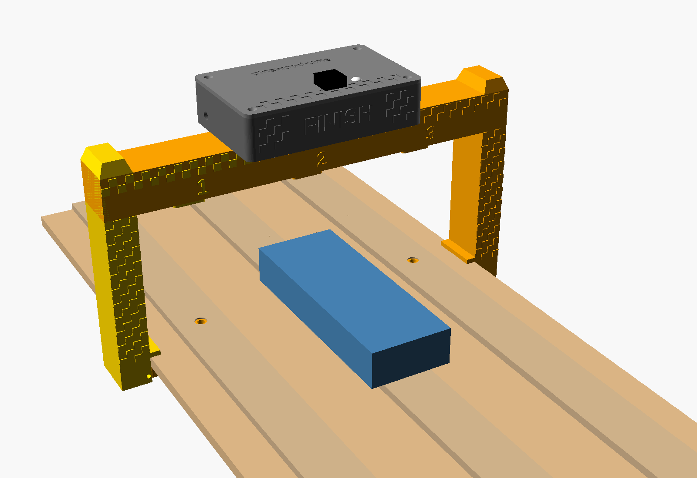
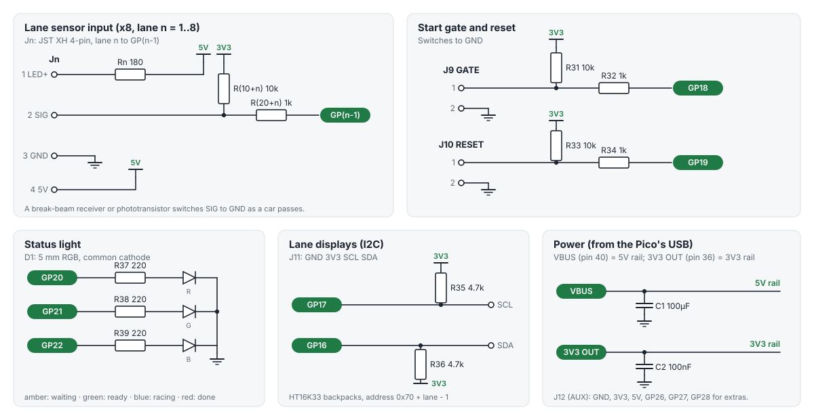
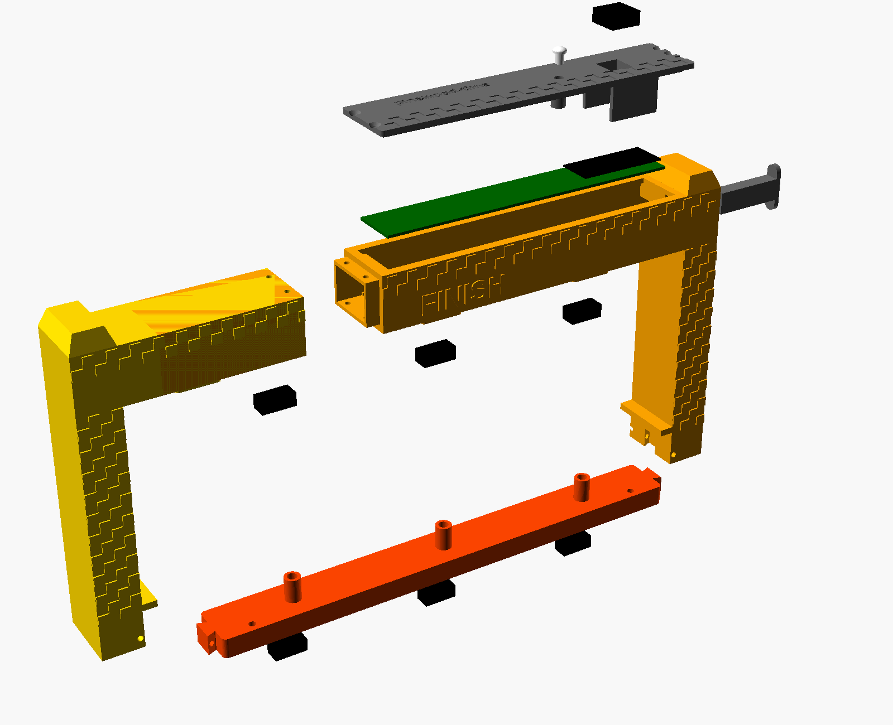
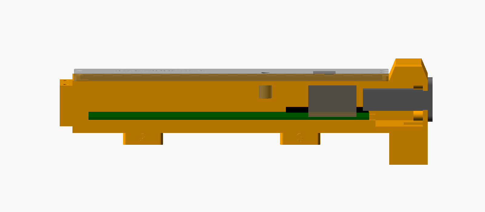
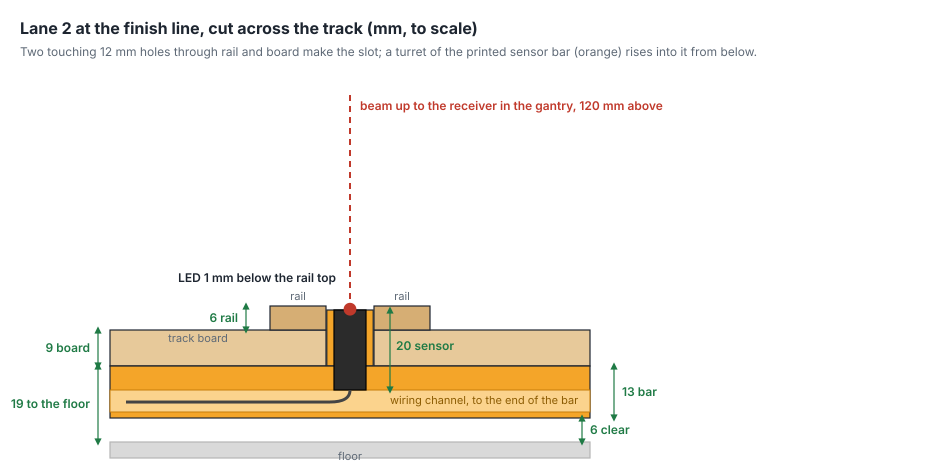
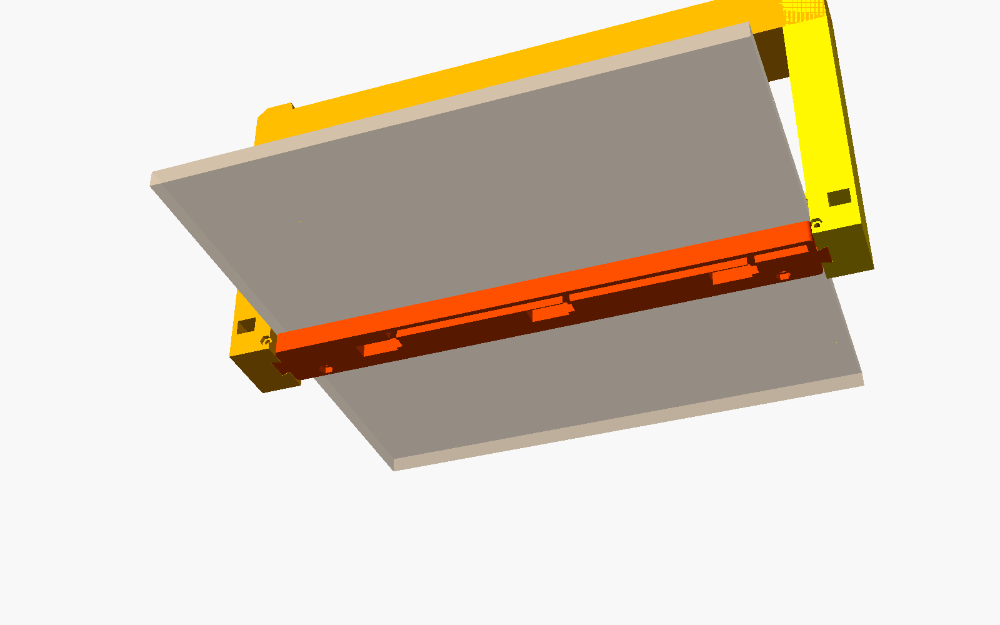
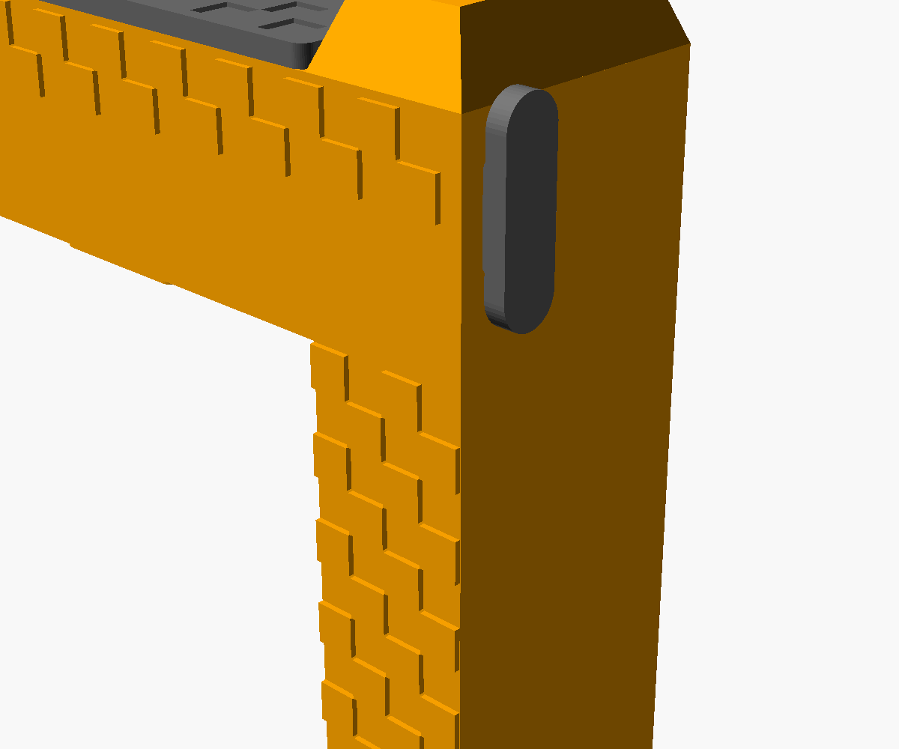

# pinewood-time

A pinewood derby race timer built on a Raspberry Pi Pico: a circuit board you solder the Pico to, with
everything a timer needs, the firmware for it, and a 3D-printed finish gate that clamps onto the track and
holds the board and a break-beam sensor for each lane.



- **Up to 8 lanes**, timed to the microsecond from the start gate opening (results to 0.0001 s)
- **PDT-compatible**: talks the protocol of the PDT timer over USB, so race software with a PDT option can drive it
- Start gate and reset button inputs; in the gate, an MX keyboard switch is the button. It can instead call
  up the next heat in the race software (a serial message, and a key press on the timer's USB keyboard)
- Optional per-lane 7-segment displays (I2C), showing a running clock, then each car's time and place
- RGB status light; sensor test mode; settings saved in flash
- All through-hole parts, 49 of them, hand-solderable; powered from the USB cable (a USB-C socket on the gate)
- Works with [Pinewood Control](https://github.com/no5tyle/pinewood-control), whose optional timer add-on fills in
  each heat's finish order and shows the times on the kiosk

> **Status:** the board passes KiCad's design rule check and the firmware builds and passes its tests, but
> no board has been made and tested yet. Build one at your own risk, and please open an issue with what you find.

## What's here

| | |
|---|---|
| [`dist/`](dist) | Firmware ready to flash: `pinewood-time-pico.uf2` (Pico, RP2040) and `pinewood-time-pico2.uf2` (Pico 2, RP2350) |
| [`hardware/fab/pinewood-time-gerbers.zip`](hardware/fab/pinewood-time-gerbers.zip) | Gerbers and drill files: upload this to a board maker |
| [`hardware/fab/bom.md`](hardware/fab/bom.md) | Parts list (also [`bom.csv`](hardware/fab/bom.csv)) |
| [`docs/wiring.md`](docs/wiring.md) | Wiring the sensors, gate, button and displays |
| [`docs/build-guide.pdf`](docs/build-guide.pdf) | The whole build as a printable guide: parts (Core Electronics and AliExpress), ordering the board, soldering, printing the gate, the track change, final assembly, testing |
| [`docs/kit-3-lane.md`](docs/kit-3-lane.md) | A 3-lane kit: shopping list (Australia), what to solder, wiring, setup |
| [`docs/protocol.md`](docs/protocol.md) | The serial protocol and settings commands |
| [`docs/schematic.svg`](docs/schematic.svg) | The circuit |
| [`firmware/`](firmware) | Firmware source (C, Pico SDK) and host tests |
| [`hardware/`](hardware) | The board, generated by script with KiCad 7 |
| [`hardware/gate/`](hardware/gate) | A 3D-printed finish gate: houses the timer and the lane sensors, with an MX key for the button |

## The board


Long and narrow (178 × 28 mm) so it fits inside the gate's beam. Lanes 1 to 8 run along the left, each a
socket with three upright resistors above it; then the start gate, reset, display and spare-pin connectors,
the status light, and the Pico at the right-hand end with its USB socket just past the end of the board.



## The finish gate



From the top: the MX key and the **top cover** (with the status light's lens), the **timer board** lying in
the beam, the two **gate halves** (joined at the beam, between lanes 1 and 2), the **receivers** that sit in
the pods under the beam, the **USB-C socket** on the right leg, and under the track the **sensor bar**,
which holds the emitters in the rails and dovetails up into both legs. All of it prints without supports;
the files and settings are in [`hardware/gate`](hardware/gate).

## 1. Order the board

Upload `hardware/fab/pinewood-time-gerbers.zip` to JLCPCB, PCBWay or similar. Settings: 2 layers,
178 × 28 mm, 1.6 mm thick, any colour, HASL (lead-free or not) is fine. Everything else at the defaults.
The board is long and narrow so it fits inside the [finish gate](hardware/gate)'s beam.

## 2. Get the parts

See [the parts list](hardware/fab/bom.md). In short, per board:

- a Raspberry Pi Pico (or Pico 2), and 2 × 20-pin 2.54 mm male headers if yours hasn't got them
- 1/4 W resistors: 8 × 180 Ω, 10 × 10k, 10 × 1k, 2 × 4.7k, 3 × 220 Ω
- capacitors: 100 µF 10 V electrolytic (6.3 mm, 2.5 mm pitch), 100 nF ceramic (5 mm pitch)
- JST XH sockets: 8 × 4-pin (B4B-XH-A), 2 × 2-pin (B2B-XH-A), and matching plugs and crimps for your cables
- 1 × 4 and 1 × 6 2.54 mm pin headers, a 5 mm common-cathode RGB LED
- a button for the RESET socket: the gate's MX key, or any push-to-make button on a cable

And for the track: a sensor per lane, a start gate switch, optionally a remote reset button and
displays. See [wiring](docs/wiring.md).

You only need to fit as many lane sockets and resistor sets as you have lanes.

## 3. Solder it

The resistors stand upright, three to a lane, with their values printed above them. Lowest parts first:
the ceramic capacitor, the resistors (body down into the circle, the bent-over lead in the other hole),
then the LED (its longest leg, the common cathode, goes in the second hole), the electrolytic capacitor
(+ to the square pad), the pin headers and JST sockets (turned to match their outlines on the board), and
the Pico last.

The Pico goes at the right-hand end with its USB socket just past the end of the board, either on pin
headers (so it can be swapped) or flat on its castellated edges. Inside the gate, solder it flat or on
short (2.5 mm) headers, so there's room above it for the MX key.

## 4. Flash the firmware

Hold the Pico's BOOTSEL button while plugging it in; it shows up as a drive called RPI-RP2 (or RP2350).
Copy the `.uf2` for your Pico onto it. It restarts as the timer: the status light blinks amber.

## 5. Assemble the gate

The board lies on two ledges inside the beam's right half, under the cover, with the Pico's USB going
into the right leg:



Each lane's emitter lies flat in the sensor bar under the track, looking up through a turret that comes up
into a 10 mm hole in the rail at the finish line; its receiver looks down from a pod under the beam. The
only change to the track is those three holes:



The sensor bar runs under the board from leg to leg and locks into both, so the gate clamps onto the track
with nothing screwed to it:



A panel-mount USB-C socket on the right leg makes it one unit: plug in any USB-C cable.



The step-by-step assembly, with the screws for each step, is in the [build guide](docs/build-guide.pdf)
and the [gate's notes](hardware/gate/README.md#assembly).

## 6. Set it up

Plug it into the race computer. It appears as a serial port (COM*n* on Windows, `/dev/ttyACM0` on Linux,
`/dev/cu.usbmodem…` on a Mac). In a serial terminal, or the race software's console:

```
#lanes 4
#save
```

Then hold reset while plugging in to check each sensor in [test mode](docs/protocol.md#test-mode), and
choose the PDT timer in your race software.

## Build it yourself

### Firmware

Needs the [Pico SDK](https://github.com/raspberrypi/pico-sdk) (2.1 or later), CMake and `arm-none-eabi-gcc`.

```bash
cmake -S firmware -B firmware/build -DPICO_SDK_PATH=/path/to/pico-sdk -DPICO_BOARD=pico
```

```bash
cmake --build firmware/build
```

Use `-DPICO_BOARD=pico2` for the Pico 2. The timer's logic is in `firmware/src/timer_core.c`, kept free of
hardware so it can be tested on a computer:

```bash
make -C firmware/test
```

GitHub Actions runs the tests and builds both UF2s on every push.

### Board

The board is a script, not a hand-drawn layout: `hardware/generate_board.py` holds every part, where it
goes and what it connects to. `hardware/build.sh` places the parts, routes the tracks with a small router of
its own (`hardware/route.py`), adds the ground pours, runs KiCad's design rule check (stopping on any error),
then writes the Gerbers, drill files, parts list, schematic and pictures. It needs KiCad 7 (its Python module
and `kicad-cli`), and Node with Playwright for the pictures (`SKIP_RENDERS=1` skips them).

```bash
hardware/build.sh
```

The result, `hardware/pinewood-time.kicad_pcb`, opens in KiCad for anyone who'd rather edit it by hand.

## Licence

MIT, see [LICENSE](LICENSE). The PDT protocol support is an independent implementation written for
compatibility; this project contains no code or design files from the PDT, and isn't connected with it.
