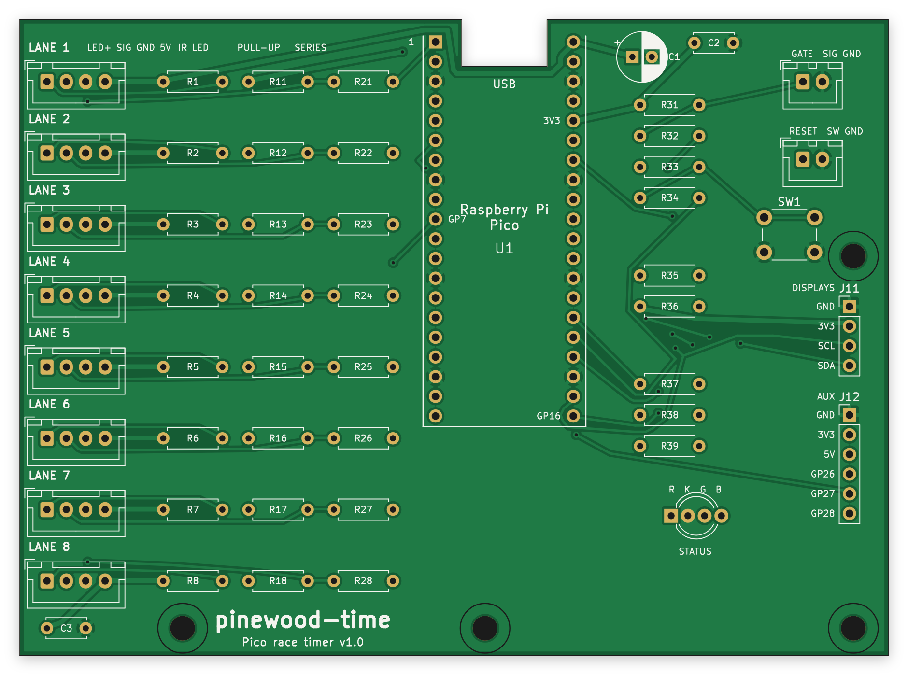

# pinewood-time

A pinewood derby race timer built on a Raspberry Pi Pico: a carrier board you solder the Pico to, with
everything a timer needs, and the firmware for it.



- **Up to 8 lanes**, timed to the microsecond from the start gate opening (results to 0.0001 s)
- **PDT-compatible**: talks the protocol of the PDT timer over USB, so race software with a PDT option can drive it
- Start gate and reset button inputs, plus a reset button on the board
- Optional per-lane 7-segment displays (I2C), showing a running clock, then each car's time and place
- RGB status light; sensor test mode; settings saved in flash
- All through-hole parts, about 50 of them, hand-solderable; powered from the USB cable

> **Status:** the board passes KiCad's design rule check and the firmware builds and passes its tests, but
> no board has been made and tested yet. Build one at your own risk, and please open an issue with what you find.

## What's here

| | |
|---|---|
| [`dist/`](dist) | Firmware ready to flash: `pinewood-time-pico.uf2` (Pico, RP2040) and `pinewood-time-pico2.uf2` (Pico 2, RP2350) |
| [`hardware/fab/pinewood-time-gerbers.zip`](hardware/fab/pinewood-time-gerbers.zip) | Gerbers and drill files: upload this to a board maker |
| [`hardware/fab/bom.md`](hardware/fab/bom.md) | Parts list (also [`bom.csv`](hardware/fab/bom.csv)) |
| [`docs/wiring.md`](docs/wiring.md) | Wiring the sensors, gate, button and displays |
| [`docs/protocol.md`](docs/protocol.md) | The serial protocol and settings commands |
| [`docs/schematic.svg`](docs/schematic.svg) | The circuit |
| [`firmware/`](firmware) | Firmware source (C, Pico SDK) and host tests |
| [`hardware/`](hardware) | The board, generated by script with KiCad 7 |

## 1. Order the board

Upload `hardware/fab/pinewood-time-gerbers.zip` to JLCPCB, PCBWay or similar. Settings: 2 layers,
112 × 82 mm, 1.6 mm thick, any colour, HASL (lead-free or not) is fine. Everything else at the defaults.

## 2. Get the parts

See [the parts list](hardware/fab/bom.md). In short, per board:

- a Raspberry Pi Pico (or Pico 2), and 2 × 20-pin 2.54 mm male headers if yours hasn't got them
- 1/4 W resistors: 8 × 180 Ω, 10 × 10k, 10 × 1k, 2 × 4.7k, 3 × 220 Ω
- capacitors: 100 µF 10 V electrolytic (6.3 mm, 2.5 mm pitch), 2 × 100 nF ceramic (5 mm pitch)
- JST XH sockets: 8 × 4-pin (B4B-XH-A), 2 × 2-pin (B2B-XH-A), and matching plugs and crimps for your cables
- 1 × 4 and 1 × 6 2.54 mm pin headers, a 6 × 6 mm tactile button, a 5 mm common-cathode RGB LED

And for the track: a sensor per lane, a start gate switch, optionally a remote reset button and
displays. See [wiring](docs/wiring.md).

You only need to fit as many lane sockets and resistor sets as you have lanes.

## 3. Solder it

Lowest parts first: resistors, the ceramic capacitors, the button, then the LED (its longest leg, the common
cathode, goes in the second hole, marked K), the electrolytic capacitor (+ to the square pad), the pin
headers and JST sockets (turned to match their outlines on the board), and the Pico last.

Solder the Pico with its USB socket over the notch in the board edge, either on pin headers (so it can be
swapped) or flat on its castellated edges.

## 4. Flash the firmware

Hold the Pico's BOOTSEL button while plugging it in; it shows up as a drive called RPI-RP2 (or RP2350).
Copy the `.uf2` for your Pico onto it. It restarts as the timer: the status light blinks amber.

## 5. Set it up

Plug it into the race computer. It appears as a serial port (COM*n* on Windows, `/dev/ttyACM0` on Linux,
`/dev/cu.usbmodem…` on a Mac). In a serial terminal, or the race software's console:

```
#lanes 4
#save
```

Then hold reset while plugging in to check each sensor in [test mode](docs/protocol.md#test-mode), and
choose the PDT timer in your race software.

## Build it yourself

### Firmware

Needs the [Pico SDK](https://github.com/raspberrypi/pico-sdk) (2.1 or later), CMake and `arm-none-eabi-gcc`.

```bash
cmake -S firmware -B firmware/build -DPICO_SDK_PATH=/path/to/pico-sdk -DPICO_BOARD=pico
```

```bash
cmake --build firmware/build
```

Use `-DPICO_BOARD=pico2` for the Pico 2. The timer's logic is in `firmware/src/timer_core.c`, kept free of
hardware so it can be tested on a computer:

```bash
make -C firmware/test
```

GitHub Actions runs the tests and builds both UF2s on every push.

### Board

The board is a script, not a hand-drawn layout: `hardware/generate_board.py` holds every part, where it
goes and what it connects to. `hardware/build.sh` places the parts, routes the tracks with a small router of
its own (`hardware/route.py`), adds the ground pours, runs KiCad's design rule check (stopping on any error),
then writes the Gerbers, drill files, parts list, schematic and pictures. It needs KiCad 7 (its Python module
and `kicad-cli`), and Node with Playwright for the pictures (`SKIP_RENDERS=1` skips them).

```bash
hardware/build.sh
```

The result, `hardware/pinewood-time.kicad_pcb`, opens in KiCad for anyone who'd rather edit it by hand.

## Licence

MIT, see [LICENSE](LICENSE). The PDT protocol support is an independent implementation written for
compatibility; this project contains no code or design files from the PDT, and isn't connected with it.
