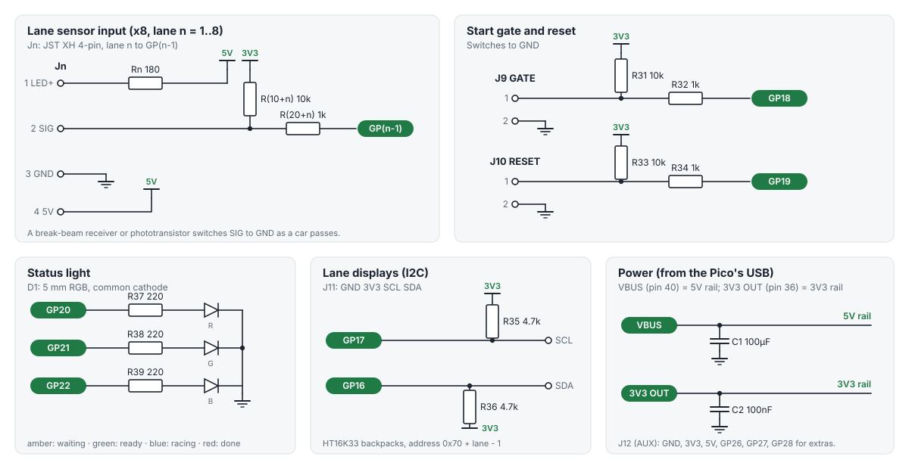

# Wiring the track

Every input on the board is pulled up to 3.3 V and reaches the Pico through a 1k resistor, so anything that
**connects the signal to GND** works: a switch, an open-collector break-beam receiver, a phototransistor.
Nothing on the track ever sees more than 5 V, and the Pico never sees more than 3.3 V.

## Lane sensors (LANE 1 to 8)

Each lane socket is a 4-pin JST XH (2.5 mm pitch):

| Pin | Name | What |
|---|---|---|
| 1 | LED+ | 5 V through the board's 180 Ω resistor (about 20 mA), for a bare IR LED |
| 2 | SIG | The sensor's output |
| 3 | GND | Ground |
| 4 | 5V | 5 V straight from USB, for sensor modules with their own electronics |

Pin 1 is the square pad, on the left (towards the board edge).

### Option A: IR break-beam modules (easiest)

The 3 mm or 5 mm IR "break beam" pairs (an emitter and a receiver, each with red/black wires, the receiver
with a white signal wire) work as they are. The receiver's output is open-collector: low while it sees the
beam, released when a car breaks it, so the default `#lane-trip high` is right.

| Wire | To pin |
|---|---|
| emitter red, receiver red | 4 (5V) |
| emitter black, receiver black | 3 (GND) |
| receiver white | 2 (SIG) |

Two wires share pins 4 and 3: twist them together into the crimp, or splice them a little way from the plug.
Mount the emitter and receiver either side of the lane (or one above, pointing down at the other under the
track), just past the finish line.

### Option B: overhead IR LED and phototransistor in the track

The classic home-made timer: an IR LED above each lane shines down on an IR phototransistor set into the
track. The phototransistor conducts (pulls SIG low) while lit and lets go when a car shades it.

| Part | To pin |
|---|---|
| IR LED anode (long leg) | 1 (LED+) |
| IR LED cathode | 3 (GND) |
| phototransistor collector | 2 (SIG) |
| phototransistor emitter | 3 (GND) |

The board's 180 Ω resistor sets the LED current, so don't add another. Use an 850 nm or 940 nm LED and a
phototransistor matched to it, and keep room light (sunlight especially) off the sensor.

If your sensors work the other way round (high while the beam is seen), send `#lane-trip low` and `#save`.

## Start gate (GATE)

A 2-pin socket: 1 = SIG, 2 = GND. Use a switch that's **closed while the gate is up** and opens as the gate
drops: a microswitch or magnetic reed switch that the gate presses or holds. That's the default
(`#gate-trip high`). For a switch that closes when the gate drops, send `#gate-trip low` and `#save`.

The timer won't get ready with the gate open (it replies `O`), so a race can't start by accident.

## Reset button (RESET)

A 2-pin socket wired across the button on the board, for a button on a cable at the start or finish:
1 = SW, 2 = GND, any push-to-make button. Press it to get ready for the next race; during a race it ends the
race. Hold it while plugging in for test mode. With `#button next` it asks the race software for the next heat instead
(see [the protocol](protocol.md#the-reset-button-next-heat)).

## Lane displays (DISPLAYS)

Optional. One 4-digit 7-segment display per lane on HT16K33 I2C "backpacks" (the common 0.56" ones), all on
the one 4-pin header: GND, 3V3, SCL, SDA. Set each backpack's address with its solder jumpers:

| Lane | 1 | 2 | 3 | 4 | 5 | 6 | 7 | 8 |
|---|---|---|---|---|---|---|---|---|
| Address | 0x70 | 0x71 | 0x72 | 0x73 | 0x74 | 0x75 | 0x76 | 0x77 |
| Jumpers (A2 A1 A0) | none | A0 | A1 | A1 A0 | A2 | A2 A0 | A2 A1 | all |

Chain them: each backpack's GND, 3V3 (VCC), SCL and SDA to the same on the next. The board has the I2C
pull-ups. The displays run from the Pico's 3.3 V supply, so they're a little dimmer than at 5 V; with all
eight, keep `#brightness` at 8 or below. Displays the timer can't find at power-on are skipped.

While a car runs its display counts up; when it's in it shows its time, then (once the race is over) its
place, `P1`, `P2`... in turn.

## Status light

| Colour | Means |
|---|---|
| Amber, blinking | Powered on: press reset (or let the software reset it) |
| Green | Ready: the race starts when the gate opens |
| Blue | Racing |
| Red | Finished: results sent |
| White | Test mode |

## AUX header

GND, 3V3, 5V, GP26, GP27, GP28: spare, for a buzzer or a start-gate solenoid driver later. The firmware
doesn't use them yet. Don't drive a solenoid straight from a pin; it needs a transistor or MOSFET and a diode.
