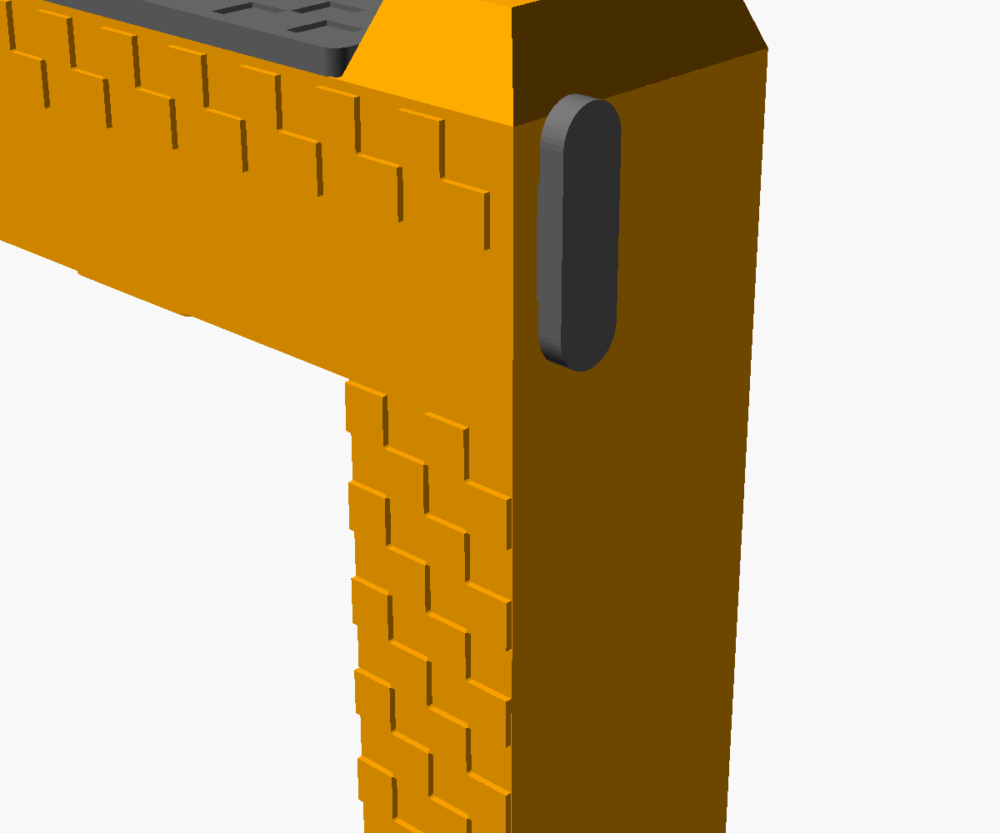

# Finish gate

A 3D-printed finish-line gantry for the 3-lane track in *Pinewood Derby Track Build* (rev 0.5). It clamps
onto the end of Track E and holds a break-beam receiver over each lane. The timer board (the long version,
178 × 28 mm) lives inside the beam under a removable top cover, which carries a socket for an MX keyboard
switch as the reset (or "next heat") button and a window for the status light. Underneath, a single sensor
bar holds the three emitters in the rails and dovetails into the legs.

Everything is in [`finish-gate.scad`](finish-gate.scad) (OpenSCAD), with the track's dimensions at the top
so it can be adjusted for another track. The jigs for drilling the track are in [`drill-jig.scad`](drill-jig.scad),
with the same dimensions. `./build.sh` re-exports the STLs and pictures.

## What it fits

From the build guide:

| | |
|---|---|
| Track board | 296 mm wide, 9 mm plywood |
| Rails | 40 × 6 mm, at 30 \| 40 \| 58 \| 40 \| 58 \| 40 \| 30 mm across the board |
| Lane (rail) centres | 50, 148 and 246 mm from the left edge |
| Under the board at the finish | 19 mm: the pine supports hold it off the floor |
| Track E tail support | 42-84 mm from the tail end, screwed at 63 mm |

The gate's legs stand just outside the board edges (0.5 mm clear), with a jaw reaching 8 mm onto the top
of the board (the outer wheels run from 15 mm in). The sensor bar runs under the board from leg to leg and
locks into both, so the gate and bar together make a frame around the board; an M4 thumbscrew in each end
of the bar presses the board up against the top jaws. The beam is 40 × 33 mm and 120 mm above the race
surface; the sensor pods under it leave 111 mm for the cars. Put the finish line at least
150 mm from the tail end, clear of the tail support and its screws; the drawings use 200 mm.

The track has no stopping area after the finish, so plan something to catch the cars (a towel, or a
padded board across the end).

## Parts

| File | Print | Notes |
|---|---|---|
| `stl/left.stl` | 1 | left leg and the beam to between lanes 1 and 2 (124 × 185 mm on the bed) |
| `stl/right.stl` | 1 | right leg and the rest of the beam (230 × 185 mm on the bed) |
| `stl/cover.stl` | 1 | the top cover over the board (204 × 40 mm); prints upside down. MX switch socket and status light window |
| `stl/mx_blank.stl` | 1 | fills the switch socket if you don't fit a key |
| `stl/led_lens.stl` | 1 | print in white or clear; pushes into the status light window |
| `stl/sensor_bar.stl` | 1 | under the track: the three emitters, and a dovetail into each leg. 307 × 30 mm: lay it diagonally on a 256 × 256 mm bed |
| `stl/drill_jig_left.stl` | 1 | drilling jig for lanes 1 and 2 (167 × 217 mm on the bed). Only needed once, to drill the track |
| `stl/drill_jig_right.stl` | 1 | drilling jig for lane 3 (69 × 217 mm) |
| `stl/drill_bush.stl` | 1 | the pilot bush that drops into the jigs' guides |

All of it prints without supports at 0.2 mm in PLA or PETG, 3 walls, 20% infill. The halves lie on their
backs with the chequers up. For two colours, change filament for the last 0.8 mm of each half, where
the chequers and FINISH start (at 40.0 mm).

**Hardware:**

| Qty | Item | For |
|---|---|---|
| 2 | M3 × 35 bolts and nuts | down through the joint, holding the two halves together |
| 2 | M2.5 × 6 self-tapping screws | the board's left end onto its bosses |
| 4 | M3 × 12 countersunk self-tapping screws | the cover |
| 2 | M3 × 40 bolts and nuts | the lock pins through the legs and the bar's dovetails |
| 6 | M2 × 10 self-tapping screws | one through each sensor's mounting hole |
| 2 | M4 × 16 bolts and M4 nuts | the thumbscrews: the nuts press into the underside of the bar's ends, and the bolts screw up against the board until snug |
| 1 | MX switch (any) and a 1u keycap | optional: the button |
| 1 | Adafruit panel-mount USB-C to Micro-B cable (ADA4056), with its two M3 screws | optional: USB-C on the right leg |

## Sensors: will they fit?

Yes, lying flat. Each half of the Adafruit 3 mm break-beam sensor is an Omron housing 20 × 10 × 8 mm.
Its LED looks out of the broad face, 5 mm from one end. 10 mm from the LED is a 2.4 mm mounting hole
through the housing, and the cable leaves the end beside it. Both mounts hold the sensor by an M2 × 10
self-tapping screw through that hole, with its LED on the lane centre and its cable towards the left.

- **In the gantry:** a small pod under the beam over each lane holds a receiver flat, LED looking down.
  Its cable goes out of the pod's end and up into the beam. The pods hang 8.5 mm below the beam, so the
  clearance over the track is 111 mm.
- **In the track:** the sensor bar holds each emitter flat in a pocket on its underside, LED up. Its light
  goes up a 6 mm bore through the bar and a round turret that rises into a 10 mm hole through the rail
  and board, ending 1 mm below the rail top. The bar is 13 mm deep under the board, leaving 6 mm to the
  floor of the 19 mm the supports allow.

Put the **emitters in the track, shining up, and the receivers in the gantry, looking down**. That way the
receivers face the track, not the hall's lights or a sunny window.

### The sensor bar

One solid piece. Each emitter goes into its pocket from underneath, LED face up, and is screwed in with
its M2 screw. Its cable leaves the pocket's left end into a groove along the underside of the bar. Emitters
only need power, so join all three in the groove (reds together, blacks together) into one 2-core lead,
and tape over the groove to keep the wires in. The lead leaves the left end and goes up the left leg (in
at the slot at the back of the leg) and along the beam to the board.

At the board, the lead plugs into the AUX header (J12): GND on pin 1, 5V on pin 3. A 3-way 2.54 mm housing
over pins 1-3 with the middle left empty does it. Fit an inline 2-pin plug where the lead leaves the bar,
so the bar comes off for packing without opening the cover.

Each end of the bar is a dovetail that slides up into a matching socket in the leg. The socket is closed
at the top, so the bar stops just under the board. An M3 pin through the leg and the dovetail locks it.

### Modifying the track

Each lane needs a 10 mm hole through the rail and board at the finish line, 200 mm from the tail end. The
sensor bar's turrets are 9.6 mm across, so the holes have to be within about 0.2 mm of where the bar
expects them. Two printed jigs ([`drill-jig.scad`](drill-jig.scad)) put them there.

Each jig is an L. Its long side is a fence that runs down the board's side edge, with a lip at the end
that hooks over the tail end. Its short side crosses the track, sitting on the rail tops, with a 16 mm
tall drill guide over each rail. The fence sets how far across the track each hole is, from the same board
edges the gate's legs stand against. The lip sets the finish line at 200 mm. The fence also keeps the
holes square to the track.

- **`drill_jig_left`** goes against the left edge and drills lanes 1 and 2 (50 and 148 mm in).
- **`drill_jig_right`** goes against the right edge and drills lane 3 (50 mm in from that side).
- **`drill_bush`** drops into either guide to steer a 3 mm pilot drill through the middle.

Both jigs print upside down on their flat top, with no supports. Check the bush slides into a guide and
a 10 mm bit turns freely in one before using them. Printers vary, so open the guide with a 10 mm drill
by hand if it's tight.

On Track E:

1. Check the tail end is square to the board edges. The lip measures from it, so a crooked end puts
   the lanes at different distances.
2. Set the left jig on the track, the fence against the left edge and the lip against the tail end, and
   clamp it there through the arm.
3. For each of its guides: drop the bush in and drill a 3 mm pilot right through the rail and board.
   Lift the bush out.
4. Do the same with the right jig against the right edge, for lane 3.
5. Lift the jigs off. From underneath, drill 10 mm a few millimetres in at each pilot, so the
   underside doesn't splinter.
6. Clamp the jigs back on and finish each hole from the top with the 10 mm bit through the guide. A
   brad-point bit follows the pilot best.
7. Try the sensor bar in the holes before fitting the gate. If a turret binds, ease that hole with a
   round file rather than forcing it.

The sensor bar's turrets go up into these holes when the gate is fitted (below). Nothing is screwed to
the track, so the gate and bar lift off for packing.

That leaves 15 mm of rail either side of the hole, so the rail still guides the wheels. The turrets stop
1 mm below the rail top, out of reach of the cars.

The bottom of a car body breaks each beam as the car passes over the rail.

## The board in the beam

The board lies in the right half of the beam, from just past the joint to near the right leg. It rests on
a ledge along each side wall, 4 mm above the beam's floor so its leads and the sensor cables pass under
it; two M2.5 screws hold its left end to bosses, and two ribs under the cover hold the Pico's end down by
its edges. The Pico's USB socket faces the right leg.

**USB-C on the outside:** Adafruit's [panel-mount USB-C to Micro-B cable](https://core-electronics.com.au/panel-mount-cable-usb-c-to-micro-b-male-30cm.html)
(ADA4056, about A$10.60 at Core Electronics) makes the gate all-in-one. Its USB-C socket screws to the
outer face of the right leg at beam height, standing upright, and its Micro-B end plugs into the Pico; the
race computer then connects with any USB-C cable. The socket's 13 mm body runs 40.5 mm inside the beam,
in front of the Pico's plug and clear of the board, and its two M3 screws tap into bosses inside the leg.
Push the spare length of its 30 cm lead down the right leg's channel.

Without it, plug an ordinary Micro-B cable into the Pico and feed its far end down the right leg's
channel (13 × 12 mm, so a USB-A plug goes through) and out of the slot at the back, at track level.

Above the board there's 20 mm to the cover. That's room for the upright resistors, the JST sockets with
their plugs in, and the Pico on short headers; the MX key sits over the Pico. Solder the Pico flat or on
2.5 mm headers, not on tall sockets.

## Linking gates

Tracks side by side each get a gate, and the gates [link](../../docs/wiring.md#linking-gates) into one
timer: every gate is printed and built the same. Put the main gate (the one plugged into the computer) on the
left-hand track, so the links run left to right:

- **LINK IN** (from the gate on the left): its cable comes in at the slot at the back of the left leg and up
  the left leg's channel, with the emitter lead and the start gate cable.
- **LINK OUT** (to the gate on the right): its cable goes down the right leg's channel and out of the slot
  at its back, beside the USB lead.

Both sockets are in the middle of the board, so the cables run along the beam under it. The main gate's USB
powers the gates after it, so they don't need a USB lead.

## Assembly

1. Press the M4 nuts into the hex pockets under the ends of the sensor bar, the M3 nuts into the hex
   pockets at the back of the legs' feet and under the beam at the joint.
2. Slide the right half's tongue into the left half's beam and bolt them together with the two M3 × 35
   bolts down through the joint.
3. Feed each receiver's cable up through its pod's end into the beam, then press the receiver into the
   pod, LED down, and screw it in with an M2 × 10.
4. Screw the emitters into the sensor bar's pockets, LED up, join their wires in the groove into one
   2-core lead out of the left end, tape the groove over, and fit the inline plug. Run the matching lead
   from the board's AUX header (J12) along the beam and down the left leg's channel and out of the slot
   at its back. The gate switch's cable comes in the same way.
5. Crimp each receiver to its lane's 4-pin JST XH plug: red to pin 4 (5V), black to pin 3 (GND), white
   to pin 2 (SIG), pin 1 empty. The emitters don't go to the lane plugs; they're powered by the bar's lead.
6. Wire the MX switch's two pins to a 2-pin JST XH plug for the RESET socket (J10).
7. USB-C socket: feed its Micro-B end in through the hole in the right leg from outside, and screw the
   socket's flange on with its two M3 screws. (Or, without it, feed an ordinary cable down the right leg
   from inside.) Lower the board onto its ledges, Pico to the right, plug the Micro-B into the Pico and
   everything else into its sockets, push the spare USB lead down the right leg, and screw the board's
   left end down.
8. Push the lens into the cover, clip in the switch (or the blank), and screw the cover down: its ribs
   hold the Pico's end of the board.
9. On the track: set the gate on the board at the finish line with its legs either side. From
   underneath, push the sensor bar up so its turrets go into the rail holes and its ends slide up into
   the legs' sockets, until it stops. Push the M3 pins through the legs and the bar, fit their nuts,
   and tighten the thumbscrews up against the board. Plug in the bar's lead.

The gate switch is at the far end of the track, about 9.7 m away, so its 2-core cable is long. That's
fine for a switch to ground with the board's pull-up, but run it along the underside of the track, away
from mains leads.

## Timing note

Adafruit gives the receiver's response time as under 2 ms. If every lane's receiver responds equally
quickly, the delay cancels out between lanes, but that isn't guaranteed. So treat finishes within a couple
of thousandths of a second as ties until it has been tested on the track: run one car down each lane in
turn, and swap sensors between lanes to compare.
