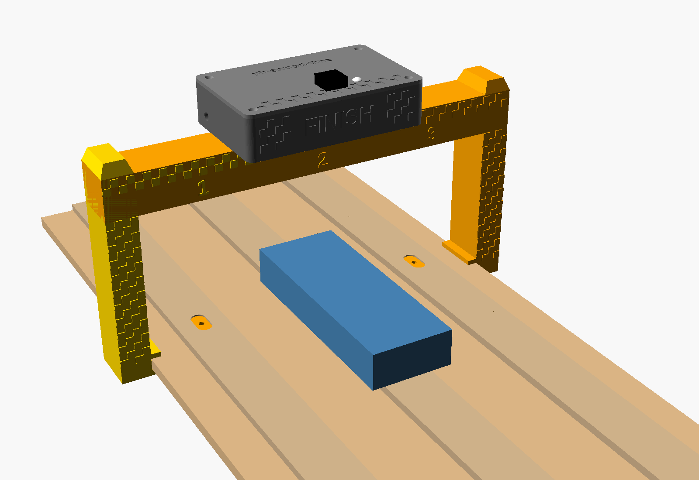
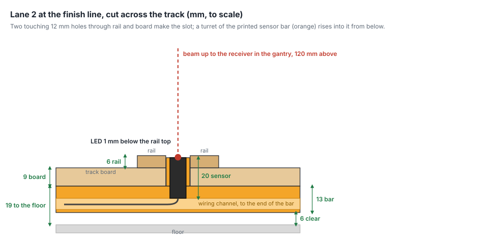

# Finish gate

A 3D-printed finish-line gantry for the 3-lane track in *Pinewood Derby Track Build* (rev 0.5). It clamps
onto the end of Track E, holds a break-beam sensor over each lane, and houses the timer board in a pod on
top, with a socket for an MX keyboard switch as the reset (or "next heat") button.

Everything is in [`finish-gate.scad`](finish-gate.scad) (OpenSCAD), with the track's dimensions at the top
so it can be adjusted for another track. `./build.sh` re-exports the STLs and pictures.

## What it fits

From the build guide:

| | |
|---|---|
| Track board | 296 mm wide, 9 mm plywood |
| Rails | 40 × 6 mm, at 30 \| 40 \| 58 \| 40 \| 58 \| 40 \| 30 mm across the board |
| Lane (rail) centres | 50, 148 and 246 mm from the left edge |
| Under the board at the finish | 19 mm: the pine supports hold it off the floor |
| Track E tail support | 42-84 mm from the tail end, screwed at 63 mm |

The gate's legs stand outside the board edges and grip them with a clamp: a jaw reaches 8 mm onto the
top of the board (the outer wheels run from 15 mm in), another goes under it, and an M4 thumbscrew pushes
the board up into the top jaw. The beam is 120 mm above the race surface. Put the finish line at least
150 mm from the tail end, clear of the tail support and its screws; the drawings use 200 mm.

The track has no stopping area after the finish, so plan something to catch the cars (a towel, or a
padded board across the end).

## Parts

| File | Print | Notes |
|---|---|---|
| `stl/left.stl` | 1 | left leg and the beam to between lanes 1 and 2 (123 × 178 mm on the bed) |
| `stl/right.stl` | 1 | right leg and the rest of the beam (229 × 178 mm on the bed) |
| `stl/pod.stl` | 1 | the timer board's housing, FINISH on the front |
| `stl/lid.stl` | 1 | prints upside down; MX switch socket and status light window |
| `stl/mx_blank.stl` | 1 | fills the switch socket if you don't fit a key |
| `stl/led_lens.stl` | 1 | print in white or clear; pushes into the status light window |
| `stl/track_holder.stl` | 3 | one per lane, set into the track |

All of it prints without supports at 0.2 mm in PLA or PETG, 3 walls, 20% infill. The halves lie on their
backs with the chequers up. For two colours, change filament for the last 0.8 mm of each half, where
the chequers and lane numbers start (at 40.0 mm).

**Hardware:**

| Qty | Item | For |
|---|---|---|
| 4 | M3 × 40 bolts and nuts | through the pod and beam; they also hold the two halves together |
| 4 | M3 × 8 self-tapping screws | the timer board onto its standoffs |
| 4 | M3 × 10 countersunk self-tapping screws | the lid |
| 2 | M4 × 10 bolts and M4 nuts | the clamp thumbscrews: the nuts press into the bottom jaws, and the bolts screw up until snug |
| 6 | 6G × 20 countersunk wood screws | the track holders, from underneath |
| 1 | MX switch (any) and a 1u keycap | optional: the button |

## Sensors: will they fit?

Yes. Each half of the Adafruit 3 mm break-beam sensor is 20 × 10 × 8 mm.

- **In the gantry:** a pocket over each lane centre in the underside of the beam. The sensor pushes up
  from below, cable first, until its LED end is flush with the underside. A sleeve inside keeps it upright.
- **In the track:** the rail and board together are 15 mm thick and the sensor 20 mm long. The holder
  stands it upright inside the rail with its LED 1 mm under a window just below the rail top, and reaches
  9 mm below the board. That leaves 10 mm to the floor under the 19 mm the supports allow.

Put the **emitters in the track, shining up, and the receivers in the gantry, looking down**. That way the
receivers face the track, not the hall's lights or a sunny window.

These pockets assume the LED looks out of one end of the housing, opposite the cable. Check your sensors
before cutting the track: if the LED is on a broad face instead, change `sen` and the holder in the `.scad`.

### Modifying the track

On Track E, for each lane:

1. Mark the finish line square across the board, 200 mm from the tail end.
2. On each rail centre line (50, 148, 246 mm from the left edge), mark two hole centres 6 mm either side of
   the finish line (12 mm apart).
3. Drill them with the 12 mm Forstner bit, the same way as the starting-gate slots: a pilot hole right
   through, a few millimetres from the underside, then finish from the top so the underside doesn't
   blow out. The two holes touch: pare or file the two cusps between them into one 12 × 24 mm slot.
4. Push a holder up from underneath and screw its base to the underside with two 6G × 20 screws.
5. Push an emitter into each holder from below, LED up, and run its cable along the underside to the
   nearer board edge (lane 2's can go either way). Tape or clip it up so it can't drag on the floor.

That leaves 14 mm of rail either side of the slot, so the rail still guides the wheels. The window sits
1 mm below the rail top, out of reach of the cars.

The bottom of a car body breaks each beam as the car passes over the rail.

## Assembly

1. Press the M4 nuts into the hex pockets in the bottom jaws.
2. Slide the right half's tongue into the left half's beam.
3. Set the pod on top and bolt down through it and the beam with the four M3 × 40 bolts, with the nuts
   inside the pod. These hold the halves together.
4. Push the receivers into the beam's three pockets from below, cable first. Feed the cables along the
   beam, up through the holes in the pod's floor at each end.
5. Feed each emitter's cable up the nearer leg (in through the slot at the back of the leg, just under the
   board) into the beam and up into the pod.
6. Join each lane's emitter and receiver into one JST XH plug, as in [wiring](../../docs/wiring.md).
7. Wire the MX switch's two pins to a 2-pin JST XH plug for the RESET socket (J10). You can leave SW1 off
   the board, since it's shut inside the pod.
8. Screw the board to its standoffs, USB towards the back. The gate switch cable comes in through a gland
   in the pod's end.
9. Push the lens into the lid, clip in the switch (or the blank), and screw the lid down.
10. Slide the gate onto the track at the finish line, holders under the beam, and tighten the thumbscrews.

The gate switch is at the far end of the track, about 9.7 m away, so its 2-core cable is long. That's
fine for a switch to ground with the board's pull-up, but run it along the underside of the track, away
from mains leads.

## Timing note

Adafruit gives the receiver's response time as under 2 ms. If every lane's receiver responds equally
quickly, the delay cancels out between lanes, but that isn't guaranteed. So treat finishes within a couple
of thousandths of a second as ties until it has been tested on the track: run one car down each lane in
turn, and swap sensors between lanes to compare.
